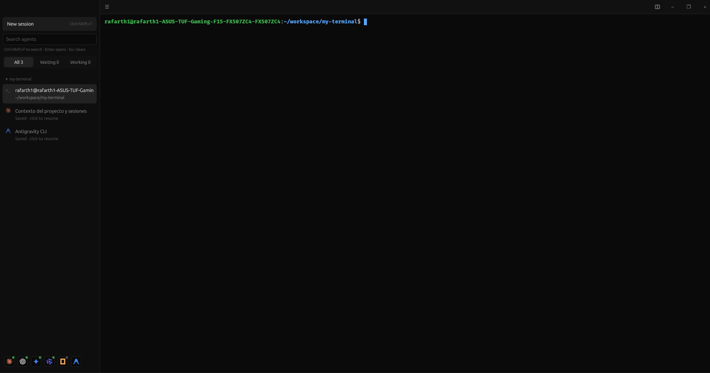

# my-terminal

Terminal ligera escrita en Rust para trabajar con sesiones de Claude Code y
otros agentes CLI: una terminal real con pestañas, paneles divididos, una barra
lateral de agentes y cambio de cuenta con un clic.



## Estructura

```
crates/
  term-core/    Sesiones de terminal sin interfaz: PTY + grilla de alacritty_terminal.
  agent-status/ Eventos de los hooks de Claude Code, estado de los agentes, IPC por socket.
                Binario `my-terminal-hook` (el comando del hook).
  app/          Aplicación de escritorio con gpui (binario `my-terminal`): ventana,
                barra lateral, paneles.
vendor/         Crates de terceros parcheados; ver vendor/README.md.
odd/tasks/      Especificaciones y registro de tareas.
```

`term-core` contiene todo lo que se puede probar sin ventana. La interfaz solo
dibuja la grilla y reenvía la entrada, así que la mayor parte del
comportamiento queda cubierta por tests rápidos sin interfaz gráfica.

## Requisitos

- Rust 1.89+ (edición 2024)
- Para la interfaz (Ubuntu):

  ```sh
  sudo apt install libxkbcommon-dev libxkbcommon-x11-dev libwayland-dev \
    libfontconfig-dev libxcb1-dev libx11-xcb-dev libssl-dev clang
  ```

## Instalar

```sh
./install.sh
```

Compila e instala la aplicación en `~/.local/bin/my-terminal`, el hook de los
agentes en `~/.cargo/bin/my-terminal-hook`, un lanzador en el menú de
aplicaciones (`~/.local/share/applications/my-terminal.desktop`) y su ícono.
Para actualizar después de cambios, se vuelve a ejecutar `./install.sh`; una
ventana abierta sigue con la versión anterior hasta cerrarla y abrirla de
nuevo. `./install.sh --uninstall` quita la aplicación, el lanzador y el ícono
(el hook y la configuración quedan).

## Ejecutar sin instalar

```sh
cargo run --release -p app
```

| Atajo | Acción |
|---|---|
| `Ctrl+Shift+T` | Nueva sesión (se abre en el directorio actual) |
| `Ctrl+Shift+Q` | Cerrar la pestaña |
| `Ctrl+Tab` / `Ctrl+Shift+Tab` | Pestaña siguiente / anterior (también `Ctrl+PgDn` / `Ctrl+PgUp`) |
| `Ctrl+Shift+D` | Dividir a la derecha |
| `Ctrl+Shift+W` | Cerrar el panel |
| `Ctrl+Shift+Right` / `Left` | Enfocar el panel siguiente / anterior |
| `Ctrl+Shift+B` | Mostrar / ocultar la barra lateral |
| `Ctrl+Shift+A` | Cambiar la cuenta de Claude de los paneles nuevos |
| `Ctrl+Shift+F` | Buscar en la salida del panel enfocado (Enter: anterior, Shift+Enter: siguiente, Esc cierra) |
| `Ctrl+Shift+K` | Buscar sesiones en la barra lateral (Enter abre la primera, Esc limpia) |
| `Ctrl+Shift+P` | Paleta de comandos |
| `Ctrl+Shift+G` | Mostrar / ocultar el panel de git |
| `Ctrl+=` / `Ctrl+-` / `Ctrl+0` | Agrandar / achicar / restablecer la fuente de todos los paneles |
| `Ctrl+clic` | Abrir la URL o la ruta `archivo:línea` bajo el ratón |
| `Ctrl+Shift+C` | Copiar la selección |
| `Ctrl+Shift+V` | Pegar (en modo *bracketed* cuando el programa lo pide) |

Ratón: arrastrar selecciona texto (doble clic selecciona una palabra, triple
clic una línea); la selección también va a la selección primaria (pegado con
clic central en otras aplicaciones). Escribir la borra. La rueda o el touchpad
recorren el historial; en programas de pantalla completa envía flechas, o
eventos de rueda si el programa sigue el ratón.

Las sesiones se listan solo en la barra lateral; la barra de título no tiene
pestañas. Las divisiones son verticales: los paneles quedan lado a lado y cada
sesión visible en la división aparece resaltada en la barra lateral. Clic
derecho sobre una sesión de la barra lateral:

- **Add to split** (una sesión que no está en pantalla): la mueve junto al
  panel enfocado.
- **Remove from split** (una sesión en una división de dos o más paneles): la
  mueve a su propia pestaña; sigue ejecutándose y permanece en la barra
  lateral.

Los botones a la derecha de la barra de título dividen el panel enfocado hacia
la derecha (el nuevo panel recibe la mitad de su ancho) y, en una división,
sacan de ella el panel enfocado. `Ctrl+Shift+W` sigue cerrando el panel
enfocado y termina su sesión. Arrastrar la línea entre dos paneles cambia su
tamaño; ningún panel queda más angosto que una décima parte de la ventana. Un
clic en un panel lo enfoca; con varios paneles, una línea azul marca el
enfocado.

Arrastrar el espacio vacío de la barra de título mueve la ventana; doble clic
la maximiza.

`Ctrl+clic` sobre una URL (`http`, `https`, `file`) la abre en el navegador.
Sobre una ruta, con o sin `:línea:columna` (`src/main.rs:42:7`), abre el
archivo, si existe, en una pestaña nueva con `$VISUAL`, `$EDITOR` o `nvim`
en esa línea; sin editor, lo abre la aplicación predeterminada. Sobre una
carpeta (`crates/app/src`, `~/Descargas`), la abre en el explorador de
archivos. Las rutas cuentan como tales si tienen una `/` (o un número de línea
y un punto, como `main.rs:12`).

La búsqueda (`Ctrl+Shift+F`) recorre la pantalla y el historial del panel:
resalta todas las coincidencias, marca la actual y muestra `n/total`. El texto
se busca tal cual (no es una expresión regular) y no distingue mayúsculas
salvo que la búsqueda tenga alguna.

Abrir my-terminal cuando ya está abierto trae al frente la ventana existente
en lugar de abrir otra (con `$XDG_RUNTIME_DIR` disponible).

## Paleta de comandos

`Ctrl+Shift+P` abre una búsqueda sobre todo lo que la aplicación puede hacer:
las acciones (con su atajo), ir a cualquier sesión abierta, reanudar una
sesión guardada, abrir cada agente instalado y cambiar de cuenta de Claude.
La búsqueda es aproximada: alcanza con algunas letras en orden (`gp` encuentra
"Toggle git panel"), y pesan más los comienzos de palabra y las letras
seguidas. ↑/↓ eligen, Enter ejecuta, Esc o un clic afuera cierran.

## Panel de git

El botón de git de la barra de título (o `Ctrl+Shift+G`) abre a la derecha un
panel con el repositorio del panel enfocado: la rama, cuántos commits va
adelante (↑) o atrás (↓) de su remoto y los archivos cambiados, con su estado
(`M` modificado, `A` agregado, `D` borrado, `R` renombrado, `U` en conflicto,
`?` sin seguimiento) y las líneas agregadas y quitadas. Un clic en un archivo
muestra su diff contra `HEAD` (un archivo nuevo aparece entero como agregado);
**← Files** vuelve a la lista. Se actualiza cada 2 segundos mientras está
abierto y con ⟳. Es de solo lectura: usa el `git` del sistema sin tomar
bloqueos opcionales, así que no interfiere con un agente que esté usando git
en el mismo repositorio.

## Configuración

El engranaje de la barra de título abre la configuración: fuente, tamaño y
tema. Los cambios se aplican al instante a todos los paneles y se guardan en
`$XDG_CONFIG_HOME/my-terminal/config.toml` (por defecto
`~/.config/my-terminal/config.toml`), que también se puede editar a mano;
todas las claves son opcionales:

```toml
font_family = "FiraCode Nerd Font Mono"
font_size = 14        # 6 a 48
theme = "dark"        # o "light"
```

El archivo se lee al iniciar; cada clave inválida o desconocida se informa por
la salida de error y deja esa clave con su valor por defecto, sin afectar a
las demás. El tema se aplica a los paneles de terminal; la
barra lateral y la de título siguen oscuras. El zoom con `Ctrl+=` / `Ctrl+-`
dura hasta cerrar la aplicación.

## Barra de agentes

La fila de íconos al pie de la barra lateral muestra Claude Code, Codex,
Qwen Code, OpenCode y Antigravity CLI (`agy`). Un punto verde
indica que la CLI tiene credenciales guardadas (punto gris: sesión cerrada); un
ícono atenuado indica que no está en el `PATH`.

- Clic: inicia el agente en una pestaña nueva, o su inicio de sesión si la
  sesión está cerrada. En Claude Code abre el diálogo de cuentas (ver más
  abajo). En un ícono atenuado abre su página de instalación en el navegador.
- Clic derecho: menú con **Open**, **Sign in** (útil cuando las credenciales
  guardadas vencieron) e **Install or repair**, que abre la página oficial de
  instalación.

my-terminal nunca lee ni guarda credenciales de los agentes: ejecuta el
comando de estado de cada CLI (`claude auth status`, `codex login status`,
`opencode auth list`) o comprueba que exista su archivo de credenciales
(`~/.qwen/oauth_creds.json`). Antigravity CLI no
tiene comando de estado, así que su ícono no muestra punto; inicia sesión en su
primera ejecución. Los estados se comprueban al iniciar, cada 5 minutos y cada
vez que se cierra una pestaña.

Una sesión de Claude Code se titula igual que en la lista de sesiones de
Claude: el último título que Claude escribió en su transcripción
(`custom-title`), o su primer prompt mientras no haya uno. Ese título es
también el que muestran las sesiones guardadas.

En la lista de sesiones, un panel que ejecuta uno de estos agentes muestra su
logo y nombre en el color de la marca (se detecta revisando los procesos bajo
el shell del panel cada 2 segundos). Los paneles de Claude Code agregan un
punto de estado sobre el logo: trabajando (azul), esperando (amarillo),
terminado (verde). El buscador sobre los filtros conserva las sesiones cuyo
título, actividad o proyecto contienen todas las palabras.

Clic derecho sobre una sesión y **Rename** permite ponerle un nombre propio
(Enter guarda, Esc cancela, vacío vuelve al título automático); el nombre se
guarda con la sesión.

Cuando una sesión de Claude Code pasa a *esperando* (pide permiso) o a
*terminado* y la ventana no tiene el foco, se muestra una notificación de
escritorio con `notify-send`.

## Sesiones guardadas

Las sesiones de agentes (Claude Code, Codex, Antigravity, ...) se guardan cada vez
que cambian en `$XDG_STATE_HOME/my-terminal/sessions.json` (por defecto
`~/.local/state/my-terminal/`, permisos 0600): título, carpeta, agente, cuenta
y, para Claude Code, su id de sesión. Los shells sin agente no se guardan.

Al siguiente inicio aparecen atenuadas en la barra lateral, como **Saved ·
click to resume**, y nada se ejecuta hasta hacer clic en una: entonces se abre
una pestaña en su carpeta, con su cuenta, que ejecuta `claude --resume <id>`
(Claude Code recupera la conversación completa desde su propio historial) o
inicia de cero el otro agente. Si la sesión estaba en una división con otras,
vuelve a esa división en su lugar y con su ancho cuando otra sesión de la
misma división ya está abierta. La pantalla de un shell y los comandos en
curso no se pueden recuperar. Clic derecho sobre una sesión guardada y **Forget
session** la elimina.

Un clic en el nombre de un proyecto de la barra lateral pliega o despliega su
grupo; esa elección también se guarda. La búsqueda muestra coincidencias
también en grupos plegados.

Cuando my-terminal se inicia desde una sesión de Claude Code, los shells que
abre no heredan las variables `CLAUDECODE` y `CLAUDE_*` de esa sesión (excepto
`CLAUDE_CONFIG_DIR` y `CLAUDE_CODE_OAUTH_TOKEN`), así Claude Code guarda su
historial con normalidad dentro de ellos.

## Cuentas de Claude

Un clic en el ícono de Claude Code de la barra de agentes abre el diálogo de
cuentas (su tooltip indica la cuenta activa). Los paneles nuevos usan la cuenta
activa; los que ya están abiertos conservan la suya. `Ctrl+Shift+A` recorre las
cuentas sin abrir el diálogo.

- **Open** (o `Enter` para la activa): inicia Claude en una pestaña nueva con
  esa cuenta, que pasa a ser la cuenta activa.
- **Default** usa el inicio de sesión que guarda `claude` (`/login`); su
  botón **Sign in** ejecuta `claude auth login` en una pestaña nueva.
- **Add account**: escribir un nombre, hacer clic en **Open claude
  setup-token** (una pestaña lo ejecuta con el inicio de sesión por defecto),
  iniciar sesión con la otra cuenta en el navegador, copiar el token que
  imprime (seleccionarlo, `Ctrl+Shift+C`), volver a hacer clic en el ícono de
  Claude y pegarlo con `Ctrl+V`. El campo del token solo muestra puntos.
- **Rename** / **Remove** actúan sobre el archivo del token; eliminar una
  cuenta nunca afecta a los paneles que ya están abiertos.

Cada cuenta adicional es un archivo `<nombre>.token` (permisos 0600) en
`$XDG_CONFIG_HOME/my-terminal/accounts` (por defecto `~/.config/...`, permisos
0700). Los paneles iniciados con ella reciben el token como
`CLAUDE_CODE_OAUTH_TOKEN`. Se ignoran los archivos que el grupo u otros
usuarios pueden leer.

## Estado de los agentes en la barra lateral

Cada panel exporta `MY_TERMINAL_PANE` y `MY_TERMINAL_SOCKET`. Los hooks de
Claude Code llaman a `my-terminal-hook`, que reenvía el evento a la aplicación
por un socket Unix en `$XDG_RUNTIME_DIR` (permisos 0700). Fuera de my-terminal
el hook no hace nada; siempre termina con código 0 y no imprime nada.

Registrarlo para estos eventos en `~/.claude/settings.json` (agregar a los
hooks existentes, sin reemplazarlos):

```json
{
  "hooks": {
    "SessionStart":     [{ "hooks": [{ "type": "command", "command": "my-terminal-hook" }] }],
    "UserPromptSubmit": [{ "hooks": [{ "type": "command", "command": "my-terminal-hook" }] }],
    "PreToolUse":       [{ "hooks": [{ "type": "command", "command": "my-terminal-hook" }] }],
    "Notification":     [{ "hooks": [{ "type": "command", "command": "my-terminal-hook" }] }],
    "Stop":             [{ "hooks": [{ "type": "command", "command": "my-terminal-hook" }] }],
    "SessionEnd":       [{ "hooks": [{ "type": "command", "command": "my-terminal-hook" }] }]
  }
}
```

Instalar el binario con `cargo install --path crates/agent-status`.

### Otros agentes

El mismo hook sirve para los demás CLIs; cada uno se registra agregando
entradas, sin reemplazar las existentes:

| Agente | Archivo | Eventos | Comando |
|---|---|---|---|
| Codex | `~/.codex/hooks.json` (mismo formato que Claude) | `SessionStart`, `UserPromptSubmit`, `PostToolUse`, `PermissionRequest`, `Stop`, `Interrupt`, `SessionEnd` | `my-terminal-hook` |
| Qwen Code | `~/.qwen/settings.json`, clave `hooks` | `SessionStart`, `UserPromptSubmit`, `PostToolUse`, `PermissionRequest`, `Notification`, `Stop`, `StopFailure`, `SessionEnd` | `my-terminal-hook` |
| Antigravity CLI | `~/.gemini/config/hooks.json`, un hook con nombre propio | `SessionStart`, `PreInvocation`, `PostToolUse`, `Stop` | `my-terminal-hook --agent agy` |
| OpenCode | `~/.config/opencode/plugins/my-terminal.ts` (copiar `integrations/opencode/my-terminal.ts`) | plugin | — |

En Antigravity, `SessionStart`, `PreInvocation` y `Stop` llevan la lista de
comandos directamente; solo `PreToolUse` y `PostToolUse` usan grupos
`{"matcher", "hooks"}` (se puede comprobar con `agy plugin validate`):

```json
{"my-terminal": {
  "SessionStart":  [{"type": "command", "command": "my-terminal-hook --agent agy", "timeout": 5}],
  "PreInvocation": [{"type": "command", "command": "my-terminal-hook --agent agy", "timeout": 5}],
  "PostToolUse":   [{"matcher": "*", "hooks": [{"type": "command", "command": "my-terminal-hook --agent agy", "timeout": 5}]}],
  "Stop":          [{"type": "command", "command": "my-terminal-hook --agent agy", "timeout": 5}]
}}
```

Codex pide aprobar los hooks nuevos una vez con `/hooks`. Antigravity no tiene
evento de "esperando" ni de fin de sesión: muestra trabajando y terminado, y
el estado se borra cuando el agente deja de correr en el panel. Para
Antigravity el hook responde `{}` (o `{"decision":"allow"}` en `Stop`, que deja
terminar al agente), como exige su formato.

## Desarrollo

```sh
cargo test --workspace
cargo clippy --workspace --all-targets
cargo fmt --all --check
```

## Limitaciones conocidas

- Los shells sin agente no se guardan, así que una división restaurada solo
  recupera los paneles de agentes.
- Un programa que imprime y termina en milisegundos puede perder su última
  salida en Linux: el PTY informa `EIO` antes de que el kernel vacíe su búfer.
  Los programas de larga duración (shells, `claude`) no se ven afectados.
